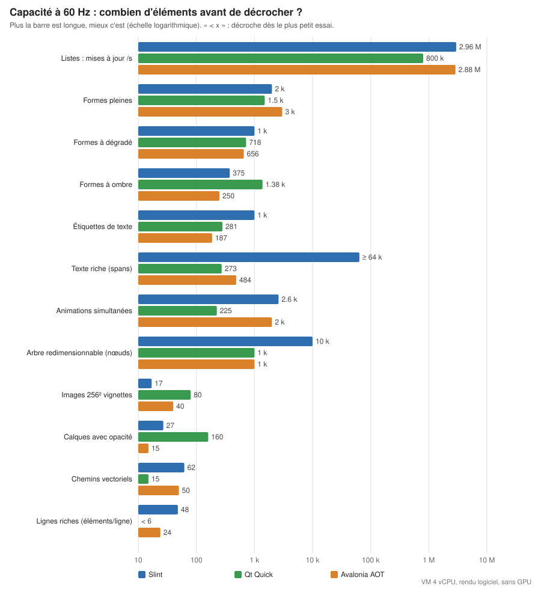
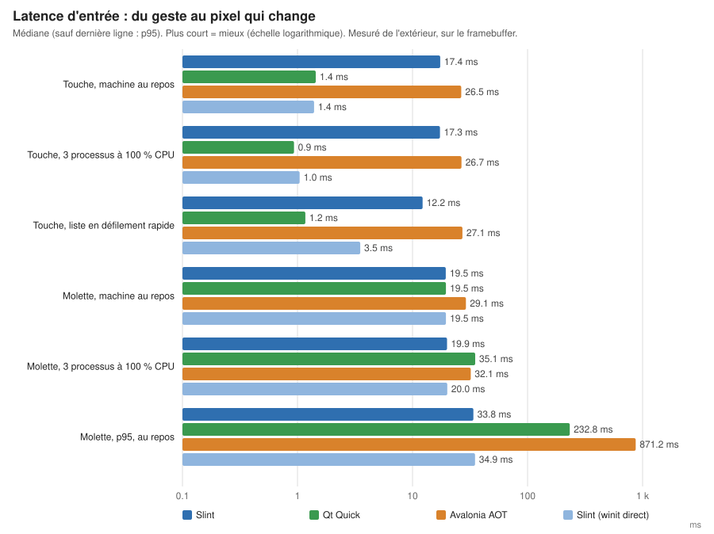
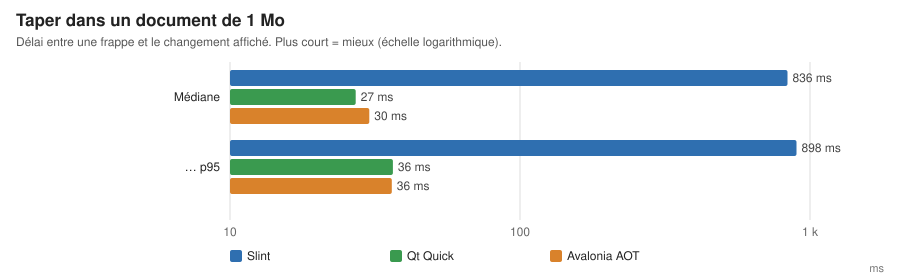
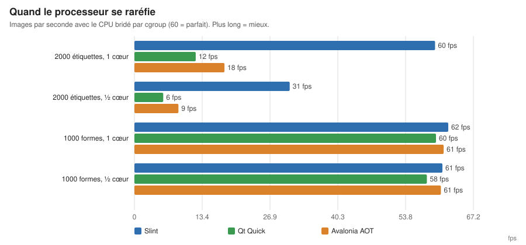
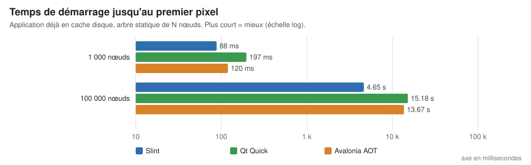
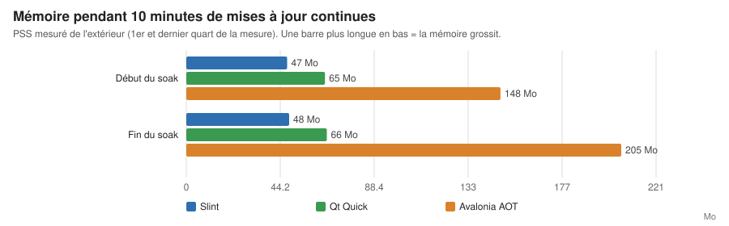
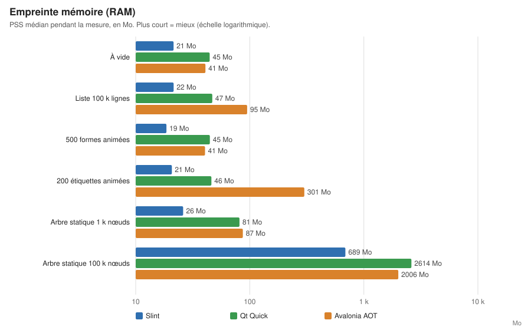
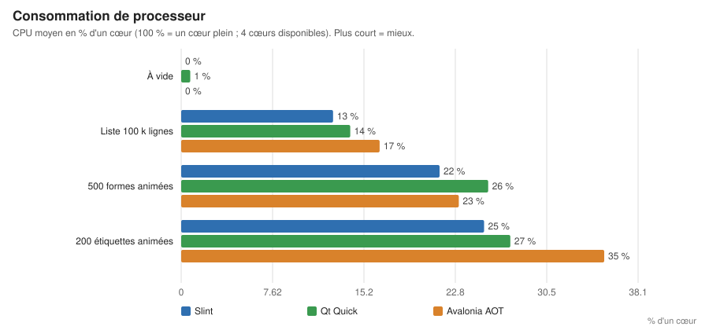

# Rapport v3 — Slint 1.18.1 vs Qt 6.12.0 vs Avalonia 12.1.4 (NativeAOT, F#)

Date : 2026-10-27. Branche `bench-v3`. Données : `v3/results/SYNTHESE.md` (générée par `v3/harness/synthese3.py` depuis les JSON bruts de `v3/results/`), spécification : `v3/docs/BENCH-SPEC-v3.md`, analyses de sources avec prédictions datées : `v3/docs/deep/{slint,qt,avalonia}.md`, notes d'implémentation : `v3/<stack>/NOTES.md` et `OPTIMIZATION-LOG.md`.

## 0. Périmètre et limites (à lire avant les chiffres)

- Les trois applications appellent le **même cœur Rust C-ABI** (`core/`) ; plus de F*, plus de F# sans FFI.
- **Machine virtuelle 4 vCPU, sans GPU, Xvfb 1280×720, rendu logiciel** pour les trois (Slint `skia-software`, Qt Quick backend `software`, Avalonia Skia CPU avec `UseRetainedFramebuffer`). Rien ici ne vaut pour un GPU, iOS, Android ou le web.
- Cadence 60 Hz imposée à toutes ; Slint et Qt tournent en fait à ~62 Hz (minuteur 16 ms). Avalonia ne permet pas de lever son plafond 60 Hz par API publique.
- **Une seule exécution par point** pour la plupart des capacités (recherche de capacité : doublement, bissection ±5 %, 2 confirmations, 8 s par sonde), 3 exécutions pour les latences et quotas, 1 pour le soak. Bruit de l'ordre de ±10–20 % sur les petits écarts ; ne pas conclure sur des écarts inférieurs.
- Critère « tient 60 Hz » : fps ≥ 58,5, ≤ 1 % de frames > 25 ms, p99 ≤ 33 ms. Variantes : `ui-tree` jugé sur le p95 des frames de redimensionnement ≤ 100 ms ; flux (`list-mutate`, `ffi-callbacks`) ≥ 99 % appliqués et ≤ 0,1 % de pertes explicites (le seuil initial de 99,9 % mesurait le retard d'une frame de drainage, pas une limite : corrigé le 2026-10-27, anciens résultats dans `v3/results/capacity_old/`).
- Le « mémoire minimale » est mesuré en pages **facturées au cgroup v1**, qui sous-estiment l'empreinte réelle (Slint : 9,9 Mo facturés sous une limite de 24 Mo). Indicatif seulement ; utiliser le PSS.
- Non fait : M1 composite (remplacé par un soak `list-mutate` 20 k/s, 600 s), profilage `perf` systématique, revue d'équité croisée par un expert de chaque stack, T1 à 100 Mo pour Slint (extrapolé ≈ 9 Go).
- Écarts d'équité connus : Avalonia utilise un delegate + `Marshal.GetFunctionPointerForDelegate` au lieu de `[<UnmanagedCallersOnly>]` (F# ne sait pas l'émettre : FS0202) ; listes Avalonia par défaut = panneau virtualisé maison (le `VirtualizingStackPanel` estime l'extent) ; listes Slint `list-rich` par défaut = anneau d'instances (`pool`) ; `checksum_data` défini différemment dans Qt et Slint.

## 1. Résultats

### En images

(Graphes générés par `v3/harness/graphes3.py` depuis `v3/results/`, sans valeur saisie à la main.)

### Détail

Voir les tableaux complets dans `v3/results/SYNTHESE.md`. Résumé par thème (valeurs mesurées ; « – » = non mesuré).

**Capacité (plus grand N à 60 Hz)** — extraits :

| Scénario | Slint | Qt | Avalonia AOT |
|---|---|---|---|
| L1 liste virtualisée (lignes) | ≥ 6,4 M | ≥ 6,4 M | ≥ 6,4 M |
| L2 lignes riches (éléments/ligne) | 48 | < 6 | 24 |
| L3 mises à jour de liste /s | 2,96 M | 0,8 M | 2,88 M |
| F2 callbacks natifs /s | ≥ 10,24 M | ≥ 10,24 M | ≥ 10,24 M |
| G1 formes pleines | 2 k | 1,5 k | 3 k |
| G1 dégradé | 1 k | 718 | 656 |
| G1 ombre | 375 | 1 375 | 250 |
| T2 étiquettes de texte | 1 k | 281 | 187 |
| T4 texte riche (spans) | ≥ 64 k | 273 | 484 |
| U1 arbre statique redimensionné ≤ 100 ms (nœuds) | 10 k | 1 k | 1 k |
| U3 animations | 2,6 k | 225 | 2 k |
| Images (G4) | 17 | 80 | 40 |

**Latence externe touche→pixel, p50 (idle)** : Slint 17,4 ms (minuteur 16 ms ; `slint-direct` avec API winit instable : 1,4 ms), Qt 1,4 ms, Avalonia 26,5 ms. **Molette→pixel** : Slint 19,5, Qt 19,5 (mais p95 jusqu'à 0,9 s sous charge), Avalonia 29 (p95 ~ 0,9 s).
**Édition d'1 Mo (T3), latence par frappe** : Slint 836 ms, Qt 27 ms, Avalonia 30 ms.
**Quota ½ cœur, 2000 étiquettes** : Slint 30,8 fps, Qt 5,7, Avalonia 8,7 ; listes et formes simples tiennent les trois.
**Démarrage (premier pixel, `ui-tree`)** : 1 k nœuds 88–197 ms à chaud ; 100 k nœuds : Slint 4,6 s, Avalonia 13,7 s, Qt 15,2 s.
**Empreinte (PSS médian ; CPU % d'un cœur)** : à vide Slint 21 Mo / Qt 45 / Avalonia 41, CPU ≈ 0 pour les trois ; liste 100 k lignes défilant : 22 / 47 / 95 Mo (Avalonia pic 137), CPU 13 / 14 / 17 % ; 200 étiquettes animées : 21 / 46 / **301** Mo, CPU 25 / 27 / 35 % ; arbre statique 100 k nœuds : 689 / 2 614 / 2 006 Mo. Taille livrée : Slint 28 Mo (un binaire), Avalonia 40 Mo, Qt 91 Mo. Le CPU est élevé par construction (rendu logiciel, pas de GPU) : comparable entre stacks, pas transposable à un appareil réel.
**Soak 600 s** : PSS Slint 47→48 Mo, Qt 65→66 Mo, Avalonia 148→205 Mo (croissance non expliquée : GC ou fuite, non tranché).

## 2. Prédictions des analystes contre mesures

(Prédictions de `v3/docs/deep/*.md`, intervalles à 80 % ; mesures ci-dessus, 1 exécution.)

| Sujet | Prédiction | Mesure | Verdict |
|---|---|---|---|
| Slint latence ≥ 16 ms | oui | 17,4 ms | confirmé |
| Slint L2 K_max ≈ 48 | 24–96 | 48 | confirmé |
| Slint G1 pleines 2–6 k, dégradé 0,7–2,5 k | | 2 k ; 1 k | dans l'intervalle (bas) |
| Slint U1 100 k, frame de redimensionnement | 0,3–0,5 s | 312 ms | confirmé |
| Slint T3 1 Mo | échec dès 10 car/s, 100–300 ms | 836 ms/frappe | pire que prévu |
| Slint ombre non rendue (renderer natif) | oui | oui (rendue via Skia logiciel, coûteuse : 375) | conforme au choix de renderer |
| Qt L1 rendu faux > ~1 M lignes | oui | corrompu à 10 M, irrégulier à 1 M (captures lues) | confirmé |
| Qt T1 gel = layout | 0,2–0,6 s à 1 Mo | 0,5 s | confirmé |
| Qt G1 (Items 0,8–2,5 k ; PaintedItem 3–8 k) | | 1,5 k | en dessous pour l'idiome par défaut |
| Qt L2 K=12–24 | | < 6 | bien pire |
| Qt U1 | 5–15 k nœuds avant 16,7 ms ; 0,5–2 s à 500 k | 99 ms à 1 k ; 9,3 s par frame à 10 k (GridLayout) | bien pire |
| Qt L3/F2 sans regroupement 100–500 k/s | | 0,8 M/s (L3) | un peu au-dessus |
| Avalonia G1 pleines 10–25 k | | 3 k | 3 à 8× trop optimiste |
| Avalonia G1 ombre 150–600 | | 250 | confirmé |
| Avalonia T3 1 Mo | 1–3 car/s max | 30 ms/frappe | prédiction fausse |
| Avalonia U1 100 k redim. | 0,3–0,8 s | 3,0–3,3 s | 4–10× pire |
| Avalonia plafond 60 Hz | oui | ~61 fps | confirmé |

Ces écarts doivent être lus comme des corrections de l'analyse par les mesures, pas comme des mesures de précision : l'analyse n'avait aucune exécution derrière elle.

## 3. Lecture pour le choix (sous réserve des limites du §0)

- **Slint** : le plus régulier sur texte en nombre (étiquettes, texte riche), arbres statiques et démarrage ; 62 Hz stable ; faible mémoire. Faiblesses mesurées : édition de gros texte (836 ms/frappe sur 1 Mo), lignes riches modérées (48), latence d'entrée de ~17 ms sans l'API instable, primitives non rendues en renderer natif (ombre, clip arrondi, rotation).
- **Qt Quick (rendu logiciel)** : latence d'entrée la plus basse et édition de texte correcte ; en revanche coût par nœud élevé : texte en nombre, arbres, lignes riches et redimensionnement s'effondrent tôt ; rendu de listes faux au-delà de ~1 M lignes (float32). Le rendu logiciel de Qt Quick n'est pas son chemin nominal (GPU/RHI) : ces résultats sous-estiment probablement Qt sur matériel réel, ce qui n'a pas été testé (backend OpenGL non revalidé en v3).
- **Avalonia NativeAOT/F#** : le plus fort sur formes pleines et sur tenue des flux de callbacks ; plafond 60 Hz, latence ~26 ms, démarrage lent sur gros arbres, texte en nombre faible ; coût d'écosystème F# (FS0202, quotations, `printf` interdits en AOT). Le gain de F# pour une base de code unique n'est pas mesuré ici.
- Aucun gagnant global : l'ordre dépend de la charge. Pour une app à gros texte éditable, Slint est le plus risqué ; pour une app à beaucoup d'éléments de texte, Qt et Avalonia le sont.

## 4. Ce qui n'a pas été fait (et ce que cela veut dire)

1. **Profilage `perf`** : jusqu'ici on a mesuré *combien* ça va vite ou lentement, pas *pourquoi*. `perf` est un outil Linux qui observe où un programme passe son temps (quelles fonctions occupent le processeur). L'étape consisterait à le lancer sur les trois cas les plus surprenants (Qt qui met 9 s par frame à redimensionner 10 000 nœuds, Avalonia 3 s pour 100 000, Slint 836 ms par frappe sur 1 Mo) pour désigner la fonction responsable. Utile pour savoir si le défaut est contournable ou structurel ; pas nécessaire pour lire les résultats.
2. **Revue d'équité croisée** : chaque implémentation a été écrite par un agent spécialiste de sa stack. Le risque est qu'un agent ait mieux optimisé « son » framework qu'un autre. La revue consiste à faire relire chaque implémentation par quelqu'un qui connaît *les autres* stacks, pour vérifier que chacune fait bien le même travail et utilise les bons réglages. Tant qu'elle n'est pas faite, de petits écarts (±20 %) ne sont pas à interpréter.
3. Répéter (≥ 5 fois) les points proches du seuil ; expliquer la croissance mémoire d'Avalonia (148 → 205 Mo).
4. Mesurer sur GPU, mobiles et autres plateformes (hors périmètre de ce cloud).

F* et les variantes v2 sont mis de côté dans `archive/` (voir `archive/README.md`), hors de la comparaison.
